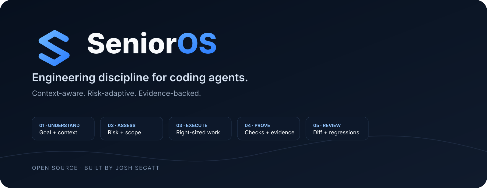
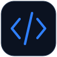

<p align="center">
  
</p>

<p align="center">
  <a href="https://github.com/joshsegatt/SeniorOS/actions/workflows/ci.yml"></a>
  <a href="https://www.npmjs.com/package/senioros"></a>
  <a href="LICENSE"></a>
  <a href="package.json"></a>
  <a href="ROADMAP.md"></a>
</p>

<p align="center">
  <strong>SeniorOS is a portable engineering harness for coding agents.</strong><br/>
  It adds selective context, risk-aware execution, deterministic verification, durable project memory, and evidence-backed completion to agentic development workflows.
</p>

<p align="center">
  <a href="#quick-start">Quick start</a> ·
  <a href="#how-it-works">How it works</a> ·
  <a href="#for-vibe-coders">Vibe coders</a> ·
  <a href="#for-senior-developers">Senior developers</a> ·
  <a href="#core-skills">Skills</a> ·
  <a href="#proof-engine">Proof</a> ·
  <a href="#evals">Evals</a> ·
  <a href="#architecture">Architecture</a>
</p>

---

## Why SeniorOS exists

Coding agents can already generate a lot of code. The expensive failures usually happen **around** the code:

- reading half the repository for a one-line change;
- reading too little before touching auth, data, or infrastructure;
- changing unrelated files because they looked “helpful”;
- declaring success without running the project's real checks;
- weakening tests instead of understanding the regression;
- forgetting architectural decisions between sessions;
- treating a button rename and a production migration with the same ritual.

SeniorOS treats these as **engineering-system problems**, not prompt-writing problems.

> **The goal is not to make the model sound senior. The goal is to make the workflow behave like disciplined engineering.**

---

## How it works

<p align="center">
  
</p>

SeniorOS pushes agent work toward a risk-adaptive loop:

```text
Goal Contract
    ↓
Relevant Context
    ↓
Risk Assessment
    ↓
Right-Sized Execution
    ↓
Proof
    ↓
Review
    ↓
Ship / Not Proven / Blocked
```

The important part is that **not every task gets the same process**.

| Task | SeniorOS behavior |
|---|---|
| Rename a button | Direct edit + proportionate verification |
| Add an API route | Light plan + relevant tests |
| Change authentication | Full context + security/risk review + proof |
| Production migration | Strict plan + rollback thinking + explicit boundaries |
| “Just make CI green” | Investigate root cause before weakening meaningful checks |

### The difference in one line

```text
normal agent loop:   request → generate → edit → "done"
SeniorOS loop:       request → understand → assess → execute → prove → review → state what is known
```

SeniorOS prefers:

```text
PROOF BASELINE: PASS
Residual risk: LOW
Skipped checks: none
```

instead of:

```text
Everything looks good! 🚀
```

because optimism remains stubbornly absent from every serious test framework.

---

## Quick start

Requires Node.js 20 or newer. No clone needed: the CLI is published on npm as [`senioros`](https://www.npmjs.com/package/senioros), and its command is `senior`.

### 1. Install the skills for your coding agent

Run inside your project:

```bash
# Claude Code — project-local
npx senioros install --target claude --scope project

# Codex — project-local
npx senioros install --target codex --scope project

# Portable / generic Agent Skills layout
npx senioros install --target generic --scope project
```

SeniorOS refuses to overwrite an existing skill unless you explicitly pass `--force`.

In Claude Code you can also install the skills as a plugin:

```text
/plugin marketplace add joshsegatt/SeniorOS
/plugin install senioros@senioros
```

**Upgrading from 0.1:** skills are now prefixed with `senior-` (`senior-debugging`, `senior-finish`, …). `senior install` lists any old, unprefixed SeniorOS skills it finds so you can delete them; it never deletes them for you.

### 2. Use the CLI

Run it once with `npx`, or install the `senior` command globally:

```bash
npm install -g senioros
```

Then, inside your project:

```bash
senior init                # create the .senior/ project state
senior inspect             # detected stack facts
senior risk --base main    # risk of the current branch
senior finish              # run the proof baseline
```

Every command also works without the global install, for example `npx senioros risk --base main`.

`senior init` creates a small, versionable project intelligence layer:

```text
.senior/
├── README.md
├── project.json
├── decisions.md
└── work-ledger.jsonl
```

### 3. Develop SeniorOS itself

```bash
git clone https://github.com/joshsegatt/SeniorOS.git
cd SeniorOS
npm install
npm run check
npm link    # puts your local build on PATH as `senior`
```

---

## Choose your path

<table>
<tr>
<td width="50%" valign="top">

### For vibe coders

You stay focused on **what you want built**.

```text
Add Google login.
```

SeniorOS encourages the agent to handle the engineering beneath that request:

```text
inspect existing auth
→ identify affected routes/models
→ assess risk
→ implement minimally
→ run real checks
→ review regressions
→ report evidence
```

**What you gain**

- less random code churn;
- fewer “fixed one thing, broke three things” sessions;
- clearer end-of-task status;
- persistent project context;
- stricter handling of risky changes without micromanaging every safe edit.

</td>
<td width="50%" valign="top">

### For senior developers

SeniorOS gives the agent explicit engineering primitives instead of a persona prompt:

- **Context as a budget** — load what the decision needs.
- **Risk-adaptive rigor** — scale process with blast radius and reversibility.
- **Deterministic mechanics** — scripts for repeatable checks.
- **Proof contracts** — completion backed by observable evidence.
- **Durable decisions** — architecture survives individual sessions.
- **Eval-driven evolution** — changes should improve measured behavior.

You keep architectural control. The harness reduces repeated supervision and makes agent behavior more inspectable.

</td>
</tr>
</table>

---

## The CLI

```bash
senior init
senior inspect
senior risk
senior risk --base main
senior finish
senior finish --json
senior prove --regression --test "npm test -- cart"
senior doctor
senior install --target claude --scope project
senior install --target codex --scope project
senior install --target generic --scope project
```

| Command | What it does |
|---|---|
| `senior init` | Creates project-level SeniorOS state and baseline intelligence files |
| `senior inspect` | Produces concise repository context for the agent |
| `senior risk` | Classifies a deterministic baseline risk from uncommitted changes |
| `senior risk --base <ref>` | Classifies a branch or PR: everything since the merge-base with `<ref>`, plus uncommitted work |
| `senior finish` | Runs available verification and reports the proof baseline |
| `senior finish --json` | Same, with a machine-readable report on stdout (script output goes to stderr) |
| `senior prove --regression --test "<cmd>"` | Proves a regression test catches the bug: passes with the fix, fails with it reverted, passes again restored |
| `senior prove --restore` | Puts the working tree back after a proof that was killed mid-run |
| `senior doctor` | Diagnoses SeniorOS installation/configuration problems |
| `senior install` | Installs the skill pack into a supported host layout |

### Current proof order

```text
typecheck → lint → test → build
```

Every check is reported as `PASS`, `FAIL`, or `SKIP`. A missing test command is **SKIP**, not “tests passed” after a brief spiritual consultation.

The proof stops at the first failure; later checks are reported as `SKIP` with the reason `not run: "<check>" failed`.

`senior risk` fails with an actionable error outside a git repository or with an unknown `--base` ref, instead of reporting a misleading `LOW`.

### Regression proof

"I added a regression test" is easy to say and often untrue: the test passes with or without the fix. `senior prove --regression` checks it:

```text
$ senior prove --regression --test "node tests/cart.test.js" --expect-failure "expected 10"
Regression proof: PROVEN
  The test passes with the fix, fails without it, and passes again after restoring it.
  Fix files, reverted for run 2: src/cart.js
  Test files, kept in place:     tests/cart.test.js
  1. with the fix      PASS    exit 0  0.1s  as expected
  2. without the fix   FAIL    exit 1  0.0s  as expected
  3. fix restored      PASS    exit 0  0.0s  as expected
  Working tree restored and verified (1 file, sha256 match).
  Evidence: .senior/runtime/evidence/…-regression.json
```

- The **fix** is every changed non-test file (or what you pass with `--fix <path>`); tests stay in place.
- `--expect-failure <regex>` requires the failure to be the original bug, not, say, a syntax error.
- `--base main` proves fixes that are already committed on a branch.
- Verdicts: `PROVEN`, or `NOT PROVEN` with `fix-fails-test`, `test-misses-bug`, `failed-for-other-reason`, `unstable` (flaky) or `interrupted`.

Your work is never at risk: every file is backed up before the fix is reverted and restored byte-for-byte, verified by sha256, even on errors or Ctrl+C. If the process is killed outright, the next proof refuses to run until `senior prove --restore` puts everything back. Evidence lives in `.senior/runtime/`, which ignores itself in git.

### Project configuration

Optional `.senior/config.json` adapts the proof and the risk rules to your project, in any language:

```json
{
  "schemaVersion": 1,
  "proof": {
    "checks": [
      { "name": "lint", "command": "ruff check ." },
      { "name": "test", "command": "pytest -q" }
    ]
  },
  "risk": {
    "ignore": ["docs/**", "**/*.snap"],
    "rules": [
      { "code": "billing", "points": 4, "reason": "Billing logic changed.", "pattern": "^src/billing/" }
    ]
  }
}
```

- `proof.checks` replaces the package-script baseline and runs in order; the proof stops at the first failure.
- `risk.rules` adds project rules (regular expressions over repository-relative paths) to the built-in ones.
- `risk.ignore` stops matching paths from counting toward risk. It never hides the built-in secrets rule.

The file is validated strictly: an unknown key, a duplicate check name or an invalid pattern makes `senior risk` and `senior finish` fail with the exact location, so a typo cannot silently turn a gate off. `senior doctor` shows whether the config is valid.

---

## Core skills

The foundation ships with six focused Agent Skills.

<table>
<tr>
<td align="center" width="72"></td>
<td><strong><a href="skills/senior-engineering/SKILL.md">senior-engineering</a></strong><br/>Risk-adaptive routing and engineering discipline for non-trivial coding work.</td>
<td align="center" width="72"></td>
<td><strong><a href="skills/senior-project-intelligence/SKILL.md">senior-project-intelligence</a></strong><br/>Builds and maintains concise, durable project context.</td>
</tr>
<tr>
<td align="center"></td>
<td><strong><a href="skills/senior-debugging/SKILL.md">senior-debugging</a></strong><br/>Reproduce, trace, test hypotheses, identify root cause, then fix minimally.</td>
<td align="center"></td>
<td><strong><a href="skills/senior-code-review/SKILL.md">senior-code-review</a></strong><br/>Evidence-based review for regressions, scope, security, and change quality.</td>
</tr>
<tr>
<td align="center"></td>
<td><strong><a href="skills/senior-finish/SKILL.md">senior-finish</a></strong><br/>Final proof baseline and semantic completion gate.</td>
<td align="center"></td>
<td><strong><a href="skills/senior-skill-authoring/SKILL.md">senior-skill-authoring</a></strong><br/>Creates focused SeniorOS-quality skills with eval contracts.</td>
</tr>
</table>

### Skill quality contract

A SeniorOS skill should:

- solve one recognizable engineering goal;
- route precisely;
- keep root `SKILL.md` concise;
- use progressive disclosure for deeper references;
- move deterministic mechanics into scripts;
- define verification and exit conditions;
- stay out of the way when heavyweight process is unnecessary;
- include eval coverage for trigger, non-trigger, and failure/edge behavior.

```bash
npm run validate:skills
npm run validate:evals
```

---

## Proof Engine

The Proof Engine exists because **“the model believes it worked” is not a production signal**.

```text
available project checks
          ↓
typecheck / lint / tests / build
          ↓
 PASS / FAIL / SKIP per check
          ↓
      proof baseline
          ↓
agent/human evaluates task-specific acceptance criteria
```

SeniorOS deliberately separates **repository checks** from **task truth**.

A green build is evidence. It does not automatically prove that a business flow, browser interaction, external integration, or data migration is correct unless that behavior was actually verified.

Future proof layers are planned around runtime assertions, browser evidence, security checks, regression baselines, task-specific acceptance contracts, and trace evidence.

---

## Project Memory

`senior init` creates explicit project memory instead of hoping conversation history behaves like an architecture database.

Example:

```markdown
## 2026-10-25 — Database ORM

Decision: Keep Drizzle.
Reason: Existing repository uses Drizzle consistently.
Do not: Introduce Prisma for unrelated features.
```

Important context becomes:

- versionable;
- inspectable;
- reviewable;
- portable across sessions and agents.

Runtime-only state belongs under `.senior/runtime/` and stays out of Git.

---

## Evals

SeniorOS treats evals as product engineering, not post-launch decoration.

The v0.1 foundation includes **18 initial eval cases** covering the core skills.

Each case captures intent such as:

```json
{
  "prompt": "task shown to the agent",
  "expected": {
    "shouldTrigger": true,
    "requiredBehaviors": ["observable behavior"],
    "forbiddenBehaviors": ["unwanted behavior"]
  }
}
```

Evaluation is designed in layers:

1. **Structural** — manifests, fixtures, repository invariants.
2. **Trajectory** — routing, files read, tools called, approvals, verification.
3. **Outcome** — builds, tests, runtime behavior, forbidden side effects.
4. **Rubric** — model grading only where human-like judgment is genuinely necessary.

See [`evals/README.md`](evals/README.md).

---

## Architecture

```text
SeniorOS
│
├── Runtime CLI
│   ├── project intelligence
│   ├── risk engine
│   ├── proof engine
│   ├── work ledger
│   └── host installer
│
├── Agent Skills
│   ├── senior engineering router
│   ├── project intelligence
│   ├── debugging
│   ├── review
│   ├── finish
│   └── authoring
│
├── Evals
│
├── Host adapters
│   ├── Claude Code
│   ├── Codex
│   └── generic Agent Skills
│
└── Project state
    └── .senior/
```

The long-term system direction expands toward:

```text
Goal Engine
Context Router
Risk Engine
Skill Router
Execution Engine
Proof Engine
Review Engine
Outer Loop
Work Ledger
Project Memory
Eval Lab
Observability
Host Adapters
```

Read [`ARCHITECTURE.md`](ARCHITECTURE.md) for system boundaries.

---

## Host support

### Claude Code

```bash
senior install --target claude --scope project
```

Project skills are installed under `.claude/skills/`.

See [`adapters/claude-code/README.md`](adapters/claude-code/README.md).

### Codex

```bash
senior install --target codex --scope project
```

SeniorOS uses project-level skills plus concise repository guidance so permanent context stays small.

See [`adapters/codex/README.md`](adapters/codex/README.md).

### Google Antigravity

Register the skills in `~/.gemini/config/skills.json`, append the routing rules to `~/.gemini/GEMINI.md`, and install three hooks that enforce context, a destructive-command guard and the proof gate.

See [`adapters/antigravity/README.md`](adapters/antigravity/README.md). The live bench that compares SeniorOS with no pack and with other packs lives in [`evals/bench/`](evals/bench/README.md).

### Generic / portable

```bash
senior install --target generic --scope project
```

Installs into `.agents/skills/`, a neutral layout suitable for host adapters and portable packaging.

---

## Design principles

1. **Proof over confidence** — observable evidence beats confident prose.
2. **Risk-adaptive process** — a typo and a production migration do not deserve the same ritual.
3. **Progressive disclosure** — load deeper guidance only when relevant.
4. **Deterministic mechanics belong in code** — repeated checks should not depend on model memory.
5. **Context is a budget** — read what is needed, not everything available.
6. **Durable project intelligence** — important decisions should survive the current chat.
7. **No surprise destructive actions** — production, credentials, irreversible data changes, deployment, and history rewrites require explicit boundaries.
8. **Portable by default** — the engineering layer should not belong to a single model vendor.
9. **Evals before mythology** — better should be measured whenever it can be measured.

---

## Brand system

<p align="center">
  
</p>

The official identity is intentionally restrained: **engineering, not science fiction**.

- Brand kit: [`brand/README.md`](brand/README.md)
- Visual guidelines: [`brand/docs/visual-style.md`](brand/docs/visual-style.md)
- Social preview source: [`brand/social/social-preview.svg`](brand/social/social-preview.svg)
- Logo assets: [`brand/logo/`](brand/logo/)

The social preview is prepared at **1280×640** for the GitHub repository settings.

---

## What SeniorOS is not

SeniorOS is not:

- another general-purpose coding model;
- a giant “act like a senior engineer” persona prompt;
- a substitute for your test suite, security program, or code review;
- permission for agents to perform destructive production work autonomously;
- tied to one model vendor;
- finished.

That last point matters. The project is shipping as a tested foundation rather than pretending its first release solved agentic engineering forever. Software already has enough heroic README fiction.

---

## Roadmap

Next major layers include:

- richer Goal Contracts;
- project graph and selective Context Engine;
- risk-aware Outer Loop;
- task-specific Proof Contracts;
- multi-agent Work Ledger and file ownership;
- controlled tool/MCP contracts;
- host-specific eval runners;
- trace grading and regression comparison;
- database, security, frontend, and deployment packs;
- evidence-derived trust scoring;
- observability for agent trajectories.

See [`ROADMAP.md`](ROADMAP.md).

---

## Security

Agent Skills can influence tool use and repository changes. Treat third-party skills as executable engineering policy, not harmless Markdown.

Read [`SECURITY.md`](SECURITY.md).

---

## Contributing

SeniorOS should become stronger through **evidence**, not longer through accumulated folklore.

If a contribution adds process, it should answer:

1. What failure mode does this prevent?
2. When should it trigger?
3. When should it stay out of the way?
4. How will we know it improved behavior?

Read [`CONTRIBUTING.md`](CONTRIBUTING.md).

---

## Creator

<p align="center">
  
</p>

<p align="center">
  <strong>SeniorOS was created by Josh Segatt.</strong><br/>
  Building a portable engineering layer for coding agents around discipline, verification, and measurable progress rather than prompt theater.
</p>

---

## License

Apache-2.0. See [`LICENSE`](LICENSE).
