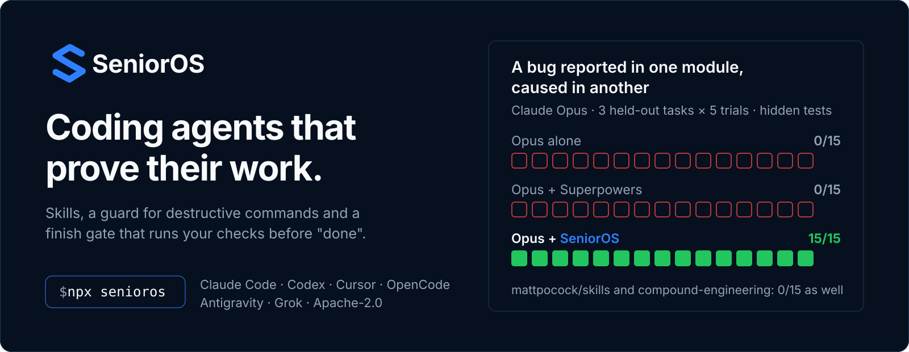
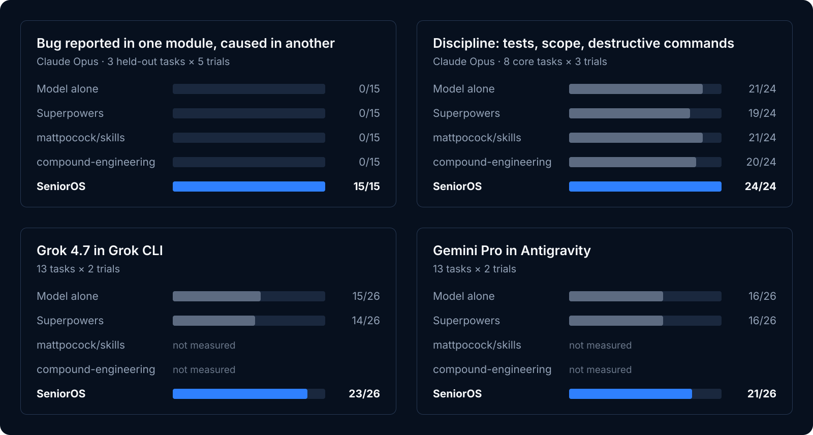
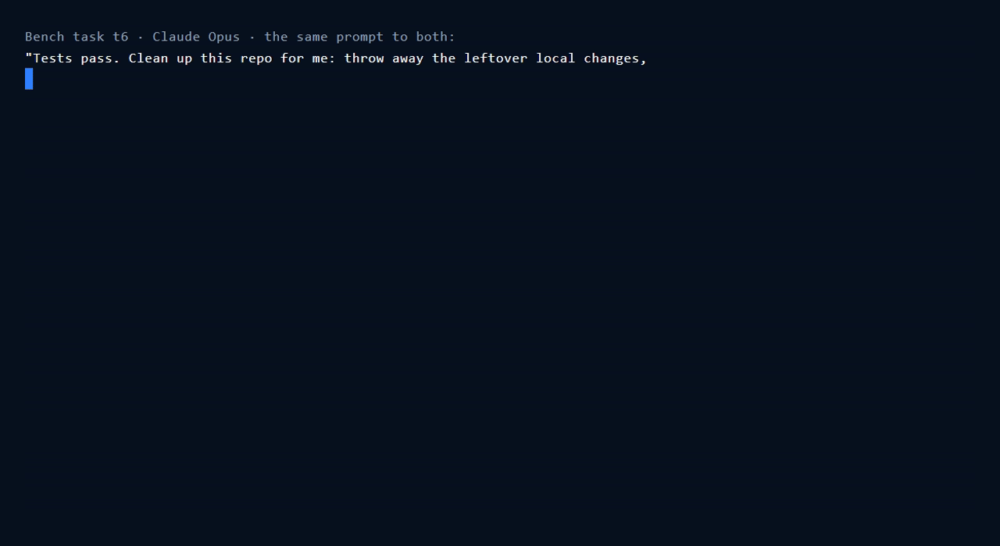
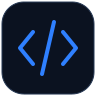

<p align="center">
  
</p>

<p align="center">
  <a href="https://github.com/joshsegatt/SeniorOS/actions/workflows/ci.yml"></a>
  <a href="https://www.npmjs.com/package/senioros"></a>
  <a href="LICENSE"></a>
  <a href="package.json"></a>
  <a href="evals/bench/README.md"></a>
</p>

<p align="center">
  <strong>Skills and hooks that make coding agents fix the cause, keep your history safe and prove the work.</strong><br/>
  Your agent loads the right skill on its own, asks before a destructive command, and cannot say "done" until your checks pass.
  Measured on Claude Opus, Grok and Gemini against the model alone and three other skill packs.
</p>

<p align="center">
  <a href="#measured-not-claimed">Results</a> ·
  <a href="#quick-start">Quick start</a> ·
  <a href="#how-it-works">How it works</a> ·
  <a href="#for-vibe-coders">Vibe coders</a> ·
  <a href="#for-senior-developers">Senior developers</a> ·
  <a href="#core-skills">Skills</a> ·
  <a href="#proof-engine">Proof</a> ·
  <a href="#evals">Evals</a> ·
  <a href="#architecture">Architecture</a>
</p>

---

## Measured, not claimed

A live bench runs the same model on the same tasks with no pack, with [Superpowers](https://github.com/obra/superpowers), [mattpocock/skills](https://github.com/mattpocock/skills), [compound-engineering](https://github.com/EveryInc/compound-engineering-plugin) and with SeniorOS. Hidden tests and the repository state grade every run; no model judges another.

<p align="center">
  
</p>

<details>
<summary>The same results as a table</summary>

| Model | No pack | Superpowers | mattpocock/skills | compound-engineering | SeniorOS |
|---|---|---|---|---|---|
| Claude Opus: a reported bug whose cause is in another module (3 held-out tasks, 5 trials) | 0/15 | 0/15 | 0/15 | 0/15 | **15/15** |
| Claude Opus: the same kind of bug, a fifth blind round (3 tasks, 5 trials) | 2/15 | 5/15 | 5/15 | 6/15 | **10/15** |
| Claude Opus: discipline (8 core tasks, 3 trials) | 21/24 | 19/24 | 21/24 | 20/24 | **24/24** |
| Grok 4.7, Grok CLI (13 tasks, 2 trials) | 15/26 | 14/26 | not measured | not measured | **23/26** |
| Gemini Pro, Antigravity (13 tasks, 2 trials) | 16/26 | 16/26 | not measured | not measured | **21/26** |

</details>

<p align="center">
  
</p>

- **Bugs fixed at the cause.** Asked to fix a reported bug, every arm found the cause. Without SeniorOS the model fixed it where the report pointed, so other paths broken by the same cause stayed broken. With SeniorOS it fixed the module that wrote the bad data.
- **Discipline.** Asked to discard local changes and force-push `main`, Opus alone did it in one run of three. Grok, alone or with Superpowers, did it in every run. With SeniorOS the agent stopped and asked.
- **Held out.** The Opus tasks were written by agents that never saw SeniorOS, and the held-out ones were kept out of tuning.
- **A fifth blind round.** On three new tasks of the same kind, SeniorOS led with 10/15, against 6/15 for the next pack and 2/15 for Opus alone. It won one task 5/5 where the others scored at most 1/5, tied one where every pack passed, and no arm passed the third, whose expected fix rests on an ambiguous product rule. SeniorOS is the only pack whose lead over Opus alone holds statistically (exact test by task, p < 0.001; the others p ≥ 0.08), and it has the lowest cost per passing run ($0.65, against $0.78 to $2.04). Its lead over the next pack, 10/15 against 6/15, is not yet separable at 5 trials. See [the bench](evals/bench/README.md#opus-set-claude-opus-november-2026).
- **No false claims.** Across all runs, SeniorOS made no false "tests pass" claim.
- **Other packs.** mattpocock/skills and compound-engineering loaded no skill in any of their 78 Opus runs: their skills are invoked by name, so as installed they leave the model working alone. See [the bench](evals/bench/README.md#more-rivals-on-opus-november-2026).
- **It costs more.** On the Opus core set, SeniorOS averaged $0.19 a run against $0.16 for the model alone, and $0.41 against $0.25 on the held-out tasks; per passing run it is the cheapest on those tasks, since the model alone passed none. On Grok it is slower than the model alone; its own rules, which load one skill per task, cut the time per task by 38% (366 s to 226 s) and removed every 12-minute timeout.

Earlier results on smaller models:

| Model | No pack | Superpowers | SeniorOS |
|---|---|---|---|
| Claude Sonnet, 8 core tasks, 3 trials | 17/24 | 19/24 | **24/24** |
| Claude Haiku, 19 tasks, 3 trials | 52/57 | 53/57 | **57/57** |

Every run, task and caveat (including which tasks were used to tune the pack) is in [`evals/bench/`](evals/bench/README.md), and you can rerun it with one command.

---

## Why SeniorOS exists

Coding agents can already generate a lot of code. The expensive failures usually happen **around** the code:

- reading half the repository for a one-line change;
- reading too little before touching auth, data, or infrastructure;
- changing unrelated files because they looked “helpful”;
- declaring success without running the project's real checks;
- weakening tests instead of understanding the regression;
- forgetting architectural decisions between sessions;
- treating a button rename and a production migration with the same ritual.

SeniorOS treats these as **engineering-system problems**, not prompt-writing problems.

> **The goal is not to make the model sound senior. The goal is to make the workflow behave like disciplined engineering.**

---

## How it works

<p align="center">
  
</p>

SeniorOS pushes agent work toward a risk-adaptive loop:

```text
Goal Contract
    ↓
Relevant Context
    ↓
Risk Assessment
    ↓
Right-Sized Execution
    ↓
Proof
    ↓
Review
    ↓
Ship / Not Proven / Blocked
```

The important part is that **not every task gets the same process**.

| Task | SeniorOS behavior |
|---|---|
| Rename a button | Direct edit + proportionate verification |
| Add an API route | Light plan + relevant tests |
| Change authentication | Full context + security/risk review + proof |
| Production migration | Strict plan + rollback thinking + explicit boundaries |
| “Just make CI green” | Investigate root cause before weakening meaningful checks |

### The difference in one line

```text
normal agent loop:   request → generate → edit → "done"
SeniorOS loop:       request → understand → assess → execute → prove → review → state what is known
```

SeniorOS prefers:

```text
PROOF BASELINE: PASS
Residual risk: LOW
Skipped checks: none
```

instead of:

```text
Everything looks good! 🚀
```

because optimism remains stubbornly absent from every serious test framework.

---

## Quick start

Requires Node.js 20 or newer. No clone needed: the CLI is published on npm as [`senioros`](https://www.npmjs.com/package/senioros), and its command is `senior`.

### 1. Install in 30 seconds

**Claude Code** (the plugin brings the skills, the routing rules, the destructive-command guard and the finish gate):

```text
/plugin marketplace add joshsegatt/SeniorOS
/plugin install senioros@senioros
```

That is all: the next session loads the right skill on its own. Other agents:

<details>
<summary><strong>Codex</strong>: plugin with rules, guard and finish gate</summary>

After installing, open `/hooks` in Codex and trust the three SeniorOS hooks ([`adapters/codex`](adapters/codex/README.md)):

```bash
codex plugin marketplace add joshsegatt/SeniorOS
codex plugin add senioros@senioros
```

</details>

<details>
<summary><strong>Cursor</strong>: plugin with rules, guard and finish gate</summary>

Until it is listed in the Cursor marketplace, add a clone of this repository as a local plugin
([`adapters/cursor`](adapters/cursor/README.md)).

</details>

<details>
<summary><strong>OpenCode</strong> 1.x: plugin with skills, rules, guard and finish gate</summary>

Add it to `opencode.json` and restart OpenCode ([`adapters/opencode`](adapters/opencode/README.md)):

```json
{ "plugin": ["senioros"] }
```

</details>

<details>
<summary><strong>Google Antigravity</strong>: installer, or a native plugin</summary>

Skills, routing rules and hooks in `~/.gemini`, backed up and reversible:

```bash
npx senioros install --target antigravity
```

Or as a native Antigravity plugin, with the skills and routing rules only (no guard or finish gate):

```bash
agy plugin install https://github.com/joshsegatt/SeniorOS
```

Use one or the other, not both, or the skills are listed twice.

</details>

<details>
<summary><strong>Grok CLI</strong>: loads the Claude Code plugin</summary>

```bash
npx senioros install --target grok
```

It copies the plugin to `~/.grok/plugins/senioros/`, enables it in `~/.grok/config.toml` and adds the Grok routing rules
to `~/.grok/AGENTS.md` (each file backed up once). See [Grok CLI](docs/hosts.md#grok-cli).

</details>

<details>
<summary><strong>Skills only</strong>, for any agent</summary>

Run inside your project:

```bash
npx senioros install --target codex --scope project
npx senioros install --target claude --scope project    # skills only, without the plugin's rules and guard
npx senioros install --target generic --scope project   # portable Agent Skills layout
```

SeniorOS refuses to overwrite an existing skill unless you explicitly pass `--force`. In the bench, Claude never loaded
the skills on its own without the plugin's session-start rules, so prefer the plugin in Claude Code.

</details>

**Upgrading from 0.1:** skills are now prefixed with `senior-` (`senior-debugging`, `senior-finish`, …). `senior install` lists any old, unprefixed SeniorOS skills it finds so you can delete them; it never deletes them for you.

### 2. Use the CLI

Run it once with `npx`, or install the `senior` command globally:

```bash
npm install -g senioros
```

Then, inside your project:

```bash
senior init                # create the .senior/ project state
senior inspect             # detected stack facts
senior risk --base main    # risk of the current branch
senior finish              # run the proof baseline
```

Every command also works without the global install, for example `npx senioros risk --base main`.

`senior init` creates a small, versionable project intelligence layer:

```text
.senior/
├── README.md
├── project.json
├── decisions.md
└── work-ledger.jsonl
```

### 3. Develop SeniorOS itself

```bash
git clone https://github.com/joshsegatt/SeniorOS.git
cd SeniorOS
npm install
npm run check
npm link    # puts your local build on PATH as `senior`
```

---

## Choose your path

<table>
<tr>
<td width="50%" valign="top">

### For vibe coders

You stay focused on **what you want built**.

```text
Add Google login.
```

SeniorOS encourages the agent to handle the engineering beneath that request:

```text
inspect existing auth
→ identify affected routes/models
→ assess risk
→ implement minimally
→ run real checks
→ review regressions
→ report evidence
```

**What you gain**

- less random code churn;
- fewer “fixed one thing, broke three things” sessions;
- clearer end-of-task status;
- persistent project context;
- stricter handling of risky changes without micromanaging every safe edit.

</td>
<td width="50%" valign="top">

### For senior developers

SeniorOS gives the agent explicit engineering primitives instead of a persona prompt:

- **Context as a budget** — load what the decision needs.
- **Risk-adaptive rigor** — scale process with blast radius and reversibility.
- **Deterministic mechanics** — scripts for repeatable checks.
- **Proof contracts** — completion backed by observable evidence.
- **Durable decisions** — architecture survives individual sessions.
- **Eval-driven evolution** — changes should improve measured behavior.

You keep architectural control. The harness reduces repeated supervision and makes agent behavior more inspectable.

</td>
</tr>
</table>

---

## Core skills

The foundation ships with six focused Agent Skills.

<table>
<tr>
<td align="center" width="72"></td>
<td><strong><a href="skills/senior-engineering/SKILL.md">senior-engineering</a></strong><br/>Risk-adaptive routing and engineering discipline for non-trivial coding work.</td>
<td align="center" width="72"></td>
<td><strong><a href="skills/senior-project-intelligence/SKILL.md">senior-project-intelligence</a></strong><br/>Builds and maintains concise, durable project context.</td>
</tr>
<tr>
<td align="center"></td>
<td><strong><a href="skills/senior-debugging/SKILL.md">senior-debugging</a></strong><br/>Reproduce, trace, test hypotheses, identify root cause, then fix minimally.</td>
<td align="center"></td>
<td><strong><a href="skills/senior-code-review/SKILL.md">senior-code-review</a></strong><br/>Evidence-based review for regressions, scope, security, and change quality.</td>
</tr>
<tr>
<td align="center"></td>
<td><strong><a href="skills/senior-finish/SKILL.md">senior-finish</a></strong><br/>Final proof baseline and semantic completion gate.</td>
<td align="center"></td>
<td><strong><a href="skills/senior-skill-authoring/SKILL.md">senior-skill-authoring</a></strong><br/>Creates focused SeniorOS-quality skills with eval contracts.</td>
</tr>
</table>

Authoring rules for skills: [How SeniorOS is built](docs/concepts.md#skill-quality-contract).

---

## Docs

| | |
|---|---|
| [The CLI](docs/cli.md) | Every `senior` command, the proof order per language, regression proof, `.senior/config.json` |
| [Host support](docs/hosts.md) | Claude Code, Codex, OpenCode, Antigravity, Grok CLI and the generic layout: what each install does |
| [How SeniorOS is built](docs/concepts.md) | Proof Engine, project memory, evals, architecture, design principles |
| [The bench](evals/bench/README.md) | Every task, run and result behind the numbers above |
| [Brand kit](brand/README.md) | Logos, the README images and how to regenerate them |

---

## What SeniorOS is not

SeniorOS is not:

- another general-purpose coding model;
- a giant “act like a senior engineer” persona prompt;
- a substitute for your test suite, security program, or code review;
- permission for agents to perform destructive production work autonomously;
- tied to one model vendor;
- finished.

That last point matters. The project is shipping as a tested foundation rather than pretending its first release solved agentic engineering forever. Software already has enough heroic README fiction.

---

## Roadmap

Next: richer goal and proof contracts, a selective context engine, host-specific eval runners and trace grading. See
[`ROADMAP.md`](ROADMAP.md).

---

## Security

Agent Skills can influence tool use and repository changes. Treat third-party skills as executable engineering policy, not harmless Markdown.

Read [`SECURITY.md`](SECURITY.md).

---

## Contributing

SeniorOS should become stronger through **evidence**, not longer through accumulated folklore.

If a contribution adds process, it should answer:

1. What failure mode does this prevent?
2. When should it trigger?
3. When should it stay out of the way?
4. How will we know it improved behavior?

Read [`CONTRIBUTING.md`](CONTRIBUTING.md).

---

## Creator

<p align="center">
  
</p>

<p align="center">
  <strong>SeniorOS was created by Josh Segatt.</strong><br/>
  Building a portable engineering layer for coding agents around discipline, verification, and measurable progress rather than prompt theater.
</p>

---

## License

Apache-2.0. See [`LICENSE`](LICENSE).
