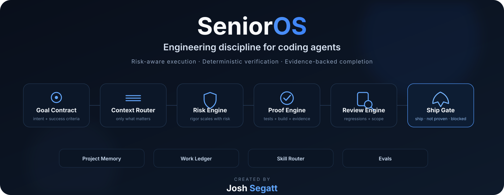
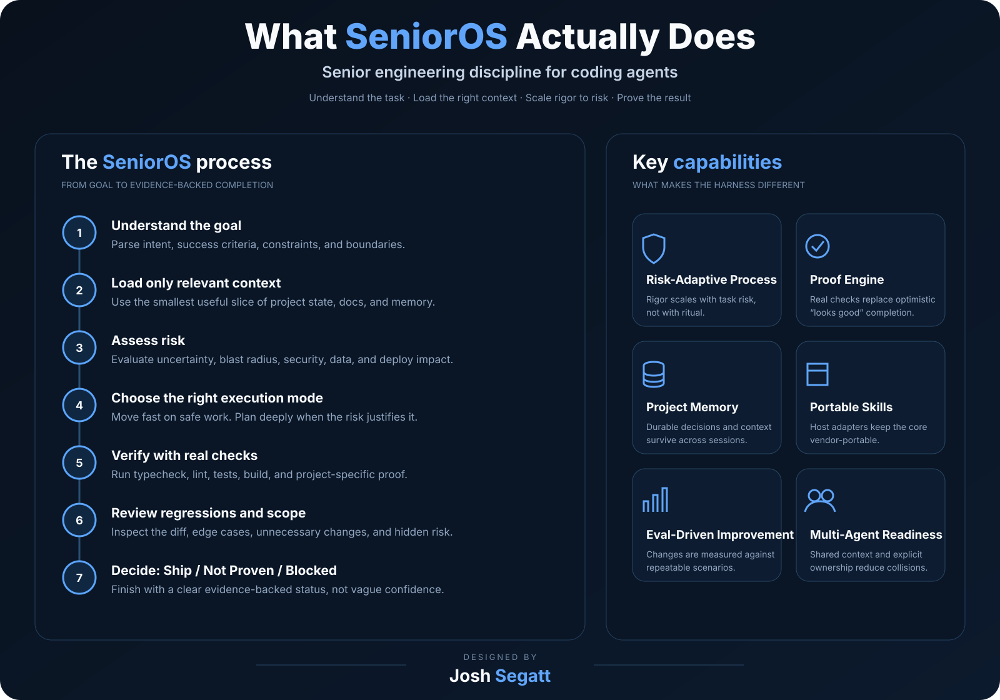

<p align="center">
  
</p>

<p align="center">
  <a href="https://github.com/joshsegatt/SeniorOS/actions/workflows/ci.yml"></a>
  <a href="LICENSE"></a>
  <a href="package.json"></a>
  <a href="ROADMAP.md"></a>
</p>

<p align="center">
  <strong>SeniorOS is an engineering harness for coding agents.</strong><br/>
  It adds risk-aware execution, selective context, deterministic verification, durable project memory, and evidence-backed completion to agentic development workflows.
</p>

<p align="center">
  <a href="#quick-start">Quick start</a> ·
  <a href="#how-it-works">How it works</a> ·
  <a href="#for-vibe-coders">Vibe coders</a> ·
  <a href="#for-senior-developers">Senior developers</a> ·
  <a href="#core-skills">Skills</a> ·
  <a href="#architecture">Architecture</a> ·
  <a href="#evals">Evals</a>
</p>

---

## Why SeniorOS exists

Coding agents are already good at generating code.

The expensive failures happen around the code:

- reading half the repository for a one-line change;
- reading too little before touching authentication or a migration;
- changing unrelated files because the model found them “interesting”;
- declaring success without running the real checks;
- weakening tests instead of understanding the regression;
- forgetting architectural decisions between sessions;
- applying the same heavyweight process to both a typo and a production database change.

SeniorOS treats these as **engineering-system problems**, not prompt-writing problems.

> **The goal is not to make the model sound senior. The goal is to make the workflow behave like disciplined engineering.**

---

## How it works

<p align="center">
  
</p>

SeniorOS routes work through a risk-adaptive loop:

```text
Goal Contract
    ↓
Relevant Context
    ↓
Risk Assessment
    ↓
Right-Sized Execution
    ↓
Proof
    ↓
Independent Review
    ↓
Ship / Not Proven / Blocked
```

The important part is that **not every task gets the same process**.

| Task | SeniorOS behavior |
|---|---|
| Rename a button | Direct edit + proportionate verification |
| Add an API route | Light plan + relevant tests |
| Change authentication | Full context + security/risk review + proof |
| Production migration | Strict plan + rollback thinking + explicit boundaries |
| “Just make CI green” | Investigate root cause before weakening meaningful checks |

<p align="center">
  
</p>

---

## What changes in practice

Without a harness, the common agent loop is roughly:

```text
request → generate → edit → “done”
```

SeniorOS pushes the workflow toward:

```text
request
  → understand
  → inspect only relevant context
  → assess risk
  → execute proportionately
  → prove behavior
  → review the diff
  → state what is actually known
```

That final distinction matters.

SeniorOS prefers:

```text
PROOF BASELINE: PASS
Residual risk: LOW
Skipped checks: none
```

instead of:

```text
Everything looks good! 🚀
```

because optimism is not a test framework.

---

## Quick start

### 1. Clone and build

```bash
git clone https://github.com/joshsegatt/SeniorOS.git
cd SeniorOS
npm install
npm run check
npm run build
npm link
```

### 2. Initialize SeniorOS inside a project

```bash
cd your-project
senior init
senior inspect
```

This creates a small, versionable project intelligence layer:

```text
.senior/
├── README.md
├── project.json
├── decisions.md
└── work-ledger.jsonl
```

### 3. Install the skills for your coding agent

```bash
# Claude Code — project-local
senior install --target claude --scope project

# Codex — project-local
senior install --target codex --scope project

# Portable / generic Agent Skills layout
senior install --target generic --scope project
```

SeniorOS will not overwrite an existing skill unless you explicitly pass `--force`.

---

## The CLI

```bash
senior init
senior inspect
senior risk
senior finish
senior doctor
senior install --target claude --scope project
senior install --target codex --scope project
senior install --target generic --scope project
```

### `senior init`

Creates the project-level SeniorOS state and baseline project intelligence files.

### `senior inspect`

Inspects the repository and produces concise information an agent can use without rereading everything from scratch.

### `senior risk`

Produces a deterministic baseline risk classification from the current change set.

Signals include:

- authentication / authorization;
- database schema and migrations;
- deployment and infrastructure;
- secrets and environment configuration;
- dependency manifests;
- CI/CD;
- deletions;
- unusually broad change sets.

### `senior finish`

Runs the proof baseline using verification commands already defined by the project.

Current stable order:

```text
typecheck → lint → test → build
```

Every check is reported as:

```text
PASS
FAIL
SKIP
```

A missing test command is **SKIP**, never magically transformed into “tests passed”. Humanity has suffered enough from creative accounting.

### `senior doctor`

Checks the SeniorOS installation and surfaces environment/configuration problems.

---

## For vibe coders

You should not need to become a framework archaeologist before asking an agent to build something.

SeniorOS is designed to let you keep prompts simple:

```text
Add Google login.
```

while the harness encourages the agent to do the boring but important work underneath:

```text
inspect existing auth
→ find affected routes and user/session models
→ assess risk
→ implement minimally
→ run real checks
→ inspect regressions
→ report evidence
```

For low-risk UI work, SeniorOS should stay out of the way.

For dangerous work, it should become stricter automatically.

### What you gain

- less random code churn;
- fewer “fixed one thing, broke three things” sessions;
- clearer end-of-task status;
- persistent project context;
- safer handling of auth, data, infrastructure, and dependencies;
- a workflow that scales as your project becomes less forgiving.

---

## For senior developers

SeniorOS is intentionally **not** a “please act like a 10x senior engineer” persona prompt.

The system is built around explicit engineering primitives:

### Context as a budget

The agent should load the context required to make a good decision, not the context available because tokens happen to exist.

### Risk-adaptive rigor

Process should scale with blast radius, reversibility, uncertainty, and affected system boundaries.

### Deterministic mechanics

Repeatable repository checks belong in code/scripts rather than being reinterpreted by the model every session.

### Proof contracts

Completion should be backed by observable evidence wherever possible.

### Durable decisions

Architectural decisions and conventions should remain inspectable instead of being trapped inside transient conversation history.

### Eval-driven evolution

A skill change should demonstrate better behavior on repeatable scenarios, not merely contain more instructions.

---

## Core skills

The v0.1 foundation ships with six core Agent Skills.

| Skill | Responsibility |
|---|---|
| [`senior-engineering`](skills/senior-engineering/SKILL.md) | Risk-adaptive engineering router and execution discipline |
| [`project-intelligence`](skills/project-intelligence/SKILL.md) | Build and maintain concise durable project context |
| [`debugging`](skills/debugging/SKILL.md) | Root-cause debugging before patching symptoms |
| [`code-review`](skills/code-review/SKILL.md) | Evidence-based review of changed code and scope |
| [`finish`](skills/finish/SKILL.md) | Proof baseline and semantic completion gate |
| [`skill-authoring`](skills/skill-authoring/SKILL.md) | Create SeniorOS-quality skills with eval contracts |

### Skill quality contract

A SeniorOS skill should:

- solve one recognizable engineering goal;
- route precisely;
- keep its root `SKILL.md` concise;
- use progressive disclosure for deep references;
- move deterministic mechanics into scripts;
- define verification and exit conditions;
- avoid forcing heavyweight process onto trivial tasks;
- include eval coverage for trigger, non-trigger, and failure/edge behavior.

Validate the skill set with:

```bash
npm run validate:skills
npm run validate:evals
```

---

## Proof Engine

The Proof Engine exists because “the model believes it worked” is not a useful production signal.

Current foundation behavior:

```text
available checks
      ↓
typecheck / lint / tests / build
      ↓
PASS / FAIL / SKIP per check
      ↓
proof baseline
      ↓
agent/human evaluates task-specific acceptance criteria
```

SeniorOS deliberately separates:

**repository checks** from **task truth**.

A green build is evidence, but it does not prove that a business workflow, production integration, browser interaction, or migration behavior is correct unless those things were actually tested.

Future releases will expand proof contracts toward:

- runtime assertions;
- browser evidence;
- security checks;
- regression baselines;
- task-specific acceptance contracts;
- trace evidence.

---

## Project Memory

`senior init` creates explicit project memory rather than asking the model to “remember the architecture”.

Example decision:

```markdown
## 2026-10-25 — Database ORM

Decision: Keep Drizzle.
Reason: Existing repository uses Drizzle consistently.
Do not: Introduce Prisma for unrelated features.
```

That makes architectural context:

- versionable;
- inspectable;
- reviewable;
- portable across sessions and agents.

Runtime-only data belongs under `.senior/runtime/` and should stay out of Git.

---

## Evals

SeniorOS treats evals as product engineering.

Each eval case describes:

```json
{
  "prompt": "task shown to the agent",
  "expected": {
    "shouldTrigger": true,
    "requiredBehaviors": ["observable behavior"],
    "forbiddenBehaviors": ["unwanted behavior"]
  }
}
```

The v0.1 foundation includes **18 initial cases** covering the core skills.

Evaluation is designed in layers:

1. **Structural** — manifests, fixtures, repository invariants.
2. **Trajectory** — routing, files read, tools called, approvals, verification.
3. **Outcome** — builds, tests, runtime behavior, forbidden side effects.
4. **Rubric** — model grading only where human-like judgment is actually necessary.

See [`evals/README.md`](evals/README.md).

---

## Architecture

```text
SeniorOS
│
├── Runtime CLI
│   ├── project intelligence
│   ├── risk engine
│   ├── proof engine
│   ├── work ledger
│   └── host installer
│
├── Agent Skills
│   ├── senior engineering router
│   ├── debugging
│   ├── review
│   ├── finish
│   └── authoring
│
├── Evals
│
├── Host adapters
│   ├── Claude Code
│   ├── Codex
│   └── generic Agent Skills
│
└── Project state
    └── .senior/
```

The long-term direction is broader than a skill pack:

```text
Goal Engine
Context Router
Risk Engine
Skill Router
Execution Engine
Proof Engine
Review Engine
Outer Loop
Work Ledger
Project Memory
Eval Lab
Observability
Host Adapters
```

Read [`ARCHITECTURE.md`](ARCHITECTURE.md) for the system boundaries.

---

## Host support

### Claude Code

Project-local installation:

```bash
senior install --target claude --scope project
```

Skills are installed under `.claude/skills/`.

See [`adapters/claude-code/README.md`](adapters/claude-code/README.md).

### Codex

Project-local installation:

```bash
senior install --target codex --scope project
```

SeniorOS uses project-level skills plus a concise `AGENTS.md` so the repository can provide durable instructions without permanently stuffing every workflow into model context.

See [`adapters/codex/README.md`](adapters/codex/README.md).

### Generic / portable

```bash
senior install --target generic --scope project
```

Installs into `.agents/skills/`, a neutral layout suitable for host adapters and portable packaging.

---

## Design principles

1. **Proof over confidence**  
   Observable evidence beats confident prose.

2. **Risk-adaptive process**  
   A typo and a production migration do not deserve the same ritual.

3. **Progressive disclosure**  
   Load deep guidance only when it is relevant.

4. **Deterministic mechanics belong in code**  
   Repeated checks should not depend on the model remembering the ceremony.

5. **Context is a budget**  
   Read what is needed, not everything available.

6. **Durable project intelligence**  
   Important decisions should survive the current chat.

7. **No surprise destructive actions**  
   Credentials, production, irreversible data changes, deployments, and history rewrites require explicit boundaries.

8. **Portable by default**  
   The engineering model should not belong to a single vendor.

9. **Evals before mythology**  
   Better should be measured whenever it can be measured.

---

## What SeniorOS is not

SeniorOS is not:

- another general-purpose coding model;
- a 5,000-line persona prompt;
- a substitute for your test suite or security program;
- permission for agents to perform destructive production work autonomously;
- tied to one model vendor;
- finished.

That last point matters. The project is intentionally shipping as a tested foundation rather than pretending the first release solved agentic engineering forever. Humans already do enough of that in software marketing.

---

## Roadmap

The current foundation proves the packaging, routing, validation, project-state, risk, and proof-baseline concepts.

Next major layers:

- richer Goal Contracts;
- project graph and selective Context Engine;
- risk-aware Outer Loop;
- task-specific Proof Contracts;
- multi-agent Work Ledger and file ownership;
- controlled tool/MCP contracts;
- host-specific eval runners;
- trace grading and regression comparison;
- database, security, frontend, and deployment packs;
- evidence-derived trust scoring;
- observability for agent trajectories.

See [`ROADMAP.md`](ROADMAP.md).

---

## Security

Agent Skills can influence tool use and repository changes. Treat third-party skills as executable engineering policy, not harmless Markdown.

SeniorOS does not assume a skill is safe because it looks readable.

Read [`SECURITY.md`](SECURITY.md).

---

## Contributing

SeniorOS should become stronger through **evidence**, not longer through accumulated folklore.

If a contribution adds process, it should answer:

1. What failure mode does this prevent?
2. When should it trigger?
3. When should it stay out of the way?
4. How will we know it improved behavior?

Read [`CONTRIBUTING.md`](CONTRIBUTING.md).

---

## Creator

<p align="center">
  <strong>SeniorOS was created by Josh Segatt.</strong>
</p>

<p align="center">
  Building a portable engineering layer for coding agents that values discipline, verification, and measurable progress over prompt theater.
</p>

---

## License

Apache-2.0. See [`LICENSE`](LICENSE).

<p align="center">
  <sub>SeniorOS · Josh Segatt · Better agents. Higher standards. Real progress.</sub>
</p>
